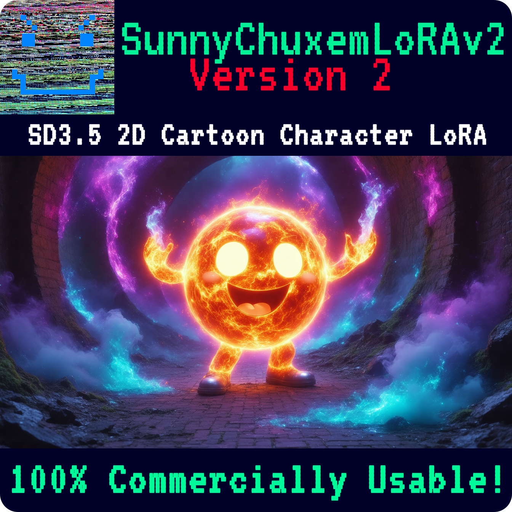
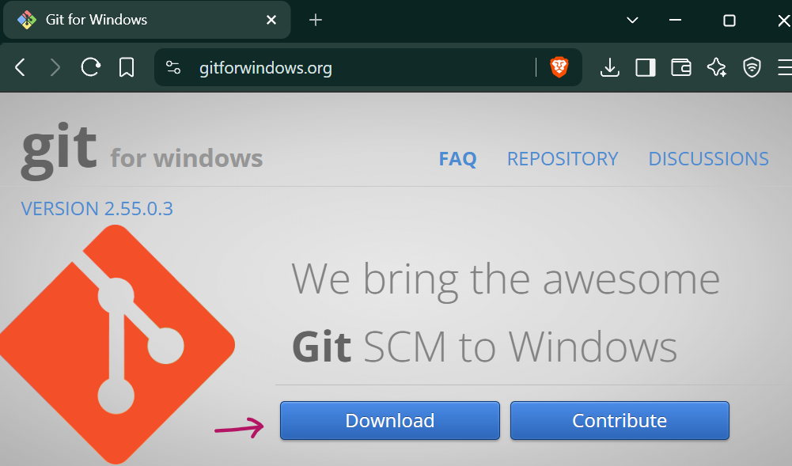
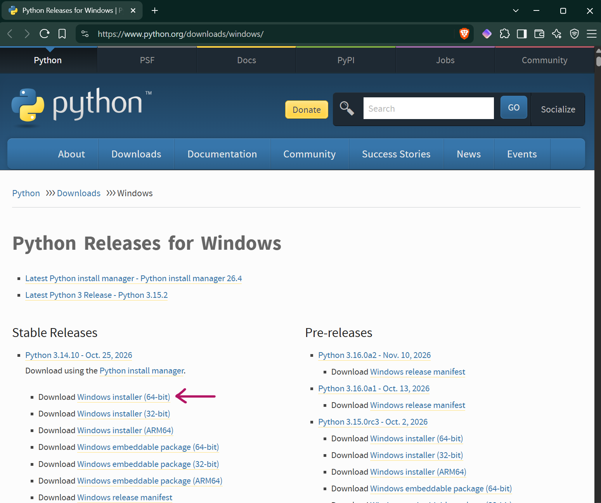
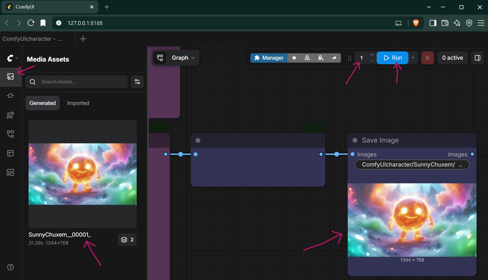

# 🌞 SunnyChuxemLoRAv2: 100% Commercially Usable Character LoRA v2.12.0


`SunnyChuxemLoRAv2` is a 100% Commercially Usable specialized character fine-tuning model architecture trained natively on **Stable Diffusion 3.5 Large** using an all-in-one local ComfyUI interface. Visit [Hugging Face](https://huggingface.co/Superklok/SunnyChuxemLoRAv2/blob/main/SunnyChuxemLoRAv2.safetensors) to download `SunnyChuxemLoRAv2` for FREE!

This LoRA reproduces the TrenchPetals Sunny Chuxem character; a bright living sun with tubular cartoon arms and legs. More information about this benchmarking character on [Toyhouse](https://toyhou.se/40566158.sunny-chuxem).

---

## 💵 The Ultimate Commercial Core
Unlike LoRAs and workflows tied to restrictive non-commercial licenses, **this entire architecture is 100% free for commercial use.** 

(NOTE: Stable Diffusion 3.5 Large is 100% Commercially Usable up to an annual revenue of under USD $1 million.)

* **Indie Game Devs:** Generate Sunny Chuxem character images, custom character variations, and concept art locally.
* **Content Creators:** Automate Sunny Chuxem character image generation.
* **IP Creators:** Monetize your Sunny Chuxem character images, workflows, original character variations, and visual outputs with zero subscription overhead.

Sunny Chuxem was created with the help of `CharacterToolkitSL`, which specializes in turning primitive MS Paint drawings, combined with text prompts, into highly detailed 100% commercially usable images. Sunny Chuxem began as a primitive MS Paint drawing, here are the steps of his development using `CharacterToolkitSL` workflows.

 ➡️ ⤵️
 ➡️ ⤵️
 ➡️ 

Visit [Upwork](https://www.upwork.com/freelancers/~01a2b86360ffeb733e)/[Contra](https://contra.com/Superklok) to get your copy of the `CharacterToolkitSL` 100% commercially usable character automation engine today!

---

## 📊 Model Technical Details



* **Base Architecture Compatibility:** Stable Diffusion 3.5 Large (fp8 scaled / fp16 / bf16)
* **Native Trained Resolution:** 1344x768 (Landscape centered-crop dataset layout)
* **Required Activation Token:** `SunnyChuxem`
* **Recommended Weight:** 0.8 - 1.0 (Use 1.0 for absolute character fidelity or dial down to 0.8 if stacking with heavy environment styles. Feel free to experiment with different values outside of the universal recommendation of 0.8 - 1.0 for character LoRAs, to see how it affects the final output image.)
* **Dataset Density:** 50 hand-selected character images at 30 processing iterations per file (3,000 total training steps).
* **Final loss value**: `0.1404`

---

## 🚀 Native ComfyUI Training Architecture
This repository includes the official `ComfyUI Workflow - SunnyChuxemLoRAv2 - SD3.5Large.json` workflow file. You can train this model locally entirely within ComfyUI without installing terminal command suites, command-line environments, or complex external dependencies.

### ⚙️ System Requirements
* **Recommended Operating System:** Windows 11
* **Minimum Processor:** Intel Core i5-10400
* **Memory:** 32GB RAM
* **Recommended Graphics Card:** Nvidia RTX 50 Series GPU - Minimum 16GB VRAM
* **Required Storage Space:** 25GB

---

## INSTALLATION GUIDE

## 🎨 Step-by-Step Setup: Automated Installation Guide

**SunnyChuxemLoRAv2** features a completely portable, 100% offline-capable architecture. All application frameworks, neural weights, and local dependencies live entirely inside your main target project folder. Follow these steps to configure the image-generation pipeline. This workflow is optimized to run on a single 16GB VRAM graphics card.

---

> ⚠️ **IMPORTANT NOTE:** Download the **SunnyChuxemLoRAv2** GitHub repository directly to the folder location where you intend to run your applications. **SunnyChuxemLoRAv2** is a fully portable and 100% offline-capable environment. All related application files, models, and caches live strictly inside the main installation folder. Once set up, you can completely disconnect your system from the internet without losing any functionality.

### Step 1: Install ComfyUI (Portable Windows Build)



1. You will first need to install Git for Windows from the official page (https://gitforwindows.org/). The direct download link is https://github.com/git-for-windows/git/releases/download/v2.55.0.windows.3/Git-2.55.0.3-64-bit.exe



2. Download and install the newest version of Python for Windows from the official page (https://www.python.org/downloads/windows/). The direct download link for the 64-bit Windows installer is https://www.python.org/ftp/python/3.14.10/python-3.14.10-amd64.exe

> ⚠️ **NOTE:**Make sure to check "Add Python to PATH" when installing the newest version of Python.

3. Download or clone this repository (`SunnyChuxemLoRAv2/`) directly to the location on your hard drive where you intend to run the application.

 ➡️ 

4. Open a standard terminal window directly inside the main `SunnyChuxemLoRAv2/` directory path (Type `cmd` in your Windows file explorer address bar and press **Enter**).

 ➡️ 

5. Run the automated visual installer script using the native Python command:

```bash
python sunnychuxemlorav2-comfyui-installer.py
```


The background engine will autonomously download the portable ComfyUI base, resolve the proprietary BCJ2 block filters using a temporary extractor asset, clone the `ComfyUI-Manager` core layers, fetch the 13.9GB Stable Diffusion 3.5 Large checkpoint, and automatically wire your local training image dataset folder (`dataset/30_SunnyChuxem/`) directly into the pipeline ingestion loops.

---

### Step 2: Load the Automated Workflow & Dependencies 


1. Browse to your newly provisioned `SunnyChuxemLoRAv2\ComfyUI_windows_portable\` folder and double-click the `run_nvidia_gpu.bat` file. A browser window will open automatically at `http://127.0.0.1:8188`. It may take a couple minutes to launch for the first time after installing ComfyUI.

2. Locate the `ComfyUI Workflow - SunnyChuxemLoRAv2 - SD3.5Large.json` workflow file inside the `SunnyChuxemLoRAv2\` folder.

 ➡️ 

3. Drag and drop the `ComfyUI Workflow - SunnyChuxemLoRAv2 - SD3.5Large.json` workflow file directly into the ComfyUI browser interface to load the automated pipeline.


4. Enter the number of LoRAs you would like to train sequentially, then press `Run` to train the amount of LoRAs you requested. Your trained LoRA `.safetensors` files can be found in the `SunnyChuxemLoRAv2\ComfyUI_windows_portable\ComfyUI\output\models\loras` folder.


When training your own LoRAs, you can use the `captioner.py` script found in your `SunnyChuxemLoRAv2\` folder to create `.txt` files to accompany each of your LoRA training images.


If you're interested in owning a custom version of the same Premium ComfyUI Workflow that generated the images used to train `SunnyChuxemLoRAv2`, then reach out through [Upwork](https://www.upwork.com/freelancers/~01a2b86360ffeb733e) or [Contra](https://contra.com/Superklok) to order your very own custom copy of the `CharacterToolkitSL` 100% Commercially Usable Character Automation Engine + SillyTavern Integration today! Here's a sample output from using the `SunnyChuxemLoRAv2` through the `CharacterToolkitSL` SillyTavern integration:

 


`CharacterToolkitSL` comes with 2 completely separate preloaded background prompts for when it's not importing information from SillyTavern to generate images, by default you have the choice between generating your own 100% commercially usable images of Sunny Chuxem in a multi-colour alien world or a mysterious purple brick sewer. The system accepts a combination of different text prompts and uploaded image files to generate the final output image. This is an example of the multi-colour portrait prompt workflow in `CharacterToolkitSL`:

 


Here's an example of the purple portrait prompt workflow in `CharacterToolkitSL`:


Your 100% Commercially Usable LoRA training workflow is ready to go, and the parameters can easily be modified to train your own custom LoRAs!

---

# 🫧 SunnyChuxemLoRAv2: Core Training Node Architecture Breakdown

This section details the specific nodes utilized within the `ComfyUI Workflow - SunnyChuxemLoRAv2 - SD3.5Large.json` local fine-tuning pipeline, outlining their parameters, hardware optimizations, and execution math.

## 📥 Dataset Ingestion & Processing Layers

### Load Image Text Dataset From Folder (`LoadImageTextDataSetFromFolder`)
* **Purpose:** Batches raw visual training layers paired with text caption sheets simultaneously.
* **Key Configuration:** `folder`: `30_SunnyChuxem`.
* **Function:** Points directly to your internal database directory, grabbing your 50 gold-standard reference frames alongside their matching `.txt` prompt descriptive files.

### Make Training Dataset (`MakeTrainingDataset`)
* **Purpose:** Packs image pixels and text strings into standardized mathematical training arrays.
* **Key Configuration:** Inputs linked to the base checkpoint’s VAE and CLIP networks.
* **Function:** Compresses raw high-resolution pixel boundaries down into unrendered latent maps using the model's native visual encoder, while transforming descriptive text scripts into clean conditioning tensors.

---

## 🤖 Base Loading & Training Engine

### Checkpoint Loader Simple (`CheckpointLoaderSimple`)
* **Purpose:** Initialized with the foundational multi-modal diffusion network.
* **Key Configuration:** `ckpt_name`: `sd3.5_large_fp8_scaled.safetensors`.
* **Function:** Loads the primary Stable Diffusion 3.5 framework blocks, splitting the logic signal into the central MODEL workspace, text routing filters (CLIP), and data converters (VAE).

### Train LoRA Node (`TrainLoraNode`)
* **Purpose:** Computes matrix error weights to fine-tune character features locally.
* **Key Configuration:** 
  * `batch_size`: 2
  * `grad_accumulation_steps`: 1
  * `steps`: 3000
  * `learning_rate`: 0.00002 (`2e-5`)
  * `rank`: 32
  * `optimizer`: "AdamW"
  * `loss_function`: "MSE"
  * `training_dtype`: "bf16"
  * `lora_dtype`: "bf16"
  * `quantized_backward`: true
  * `algorithm`: "LoRA"
  * `gradient_checkpointing`: true
  * `checkpoint_depth`: 2
  * `offloading`: true
* **Function:** The core synthesis layer of the pipeline. It maps the custom character assets across **3,000 total iterations** using modern AdamW mathematical solvers. It leverages critical hardware savers like `quantized_backward`, memory `offloading`, and `gradient_checkpointing` to drop VRAM requirements drastically, enabling local training to execute smoothly inside standard consumer GPU layouts.

---

## 💾 Output Processing

### Save LoRA (`SaveLoRA`)
* **Purpose:** Writes the completed, fine-tuned network weights permanently to disk storage.
* **Key Configuration:** `filename_prefix`: `models/loras/SunnyChuxemLoRAv2`.
* **Function:** Finalizes data processing loops and outputs a ready-to-run `.safetensors` model file directly into your local ComfyUI directory tree.

---

# 🪾 SunnyChuxemLoRAv2 Repository File Tree

```text
📁 SunnyChuxemLoRAv2/                  (Main Fine-Tuning Root Workspace Folder)
  ├── 📄 captioner.py                  (Automated Dataset Text Processing Script)
  ├── 📄 ComfyUI Workflow - SunnyChuxemLoRAv2 - SD3.5Large.json (Training Script)
  ├── 📄 CONTENTS.txt                  (Raw Directory Layout Export Data)
  ├── 📄 FUNDING.yml                   (Project Support & Sponsorship Info)
  ├── 📄 LICENSE                       (Unified Public Asset License v1.0 File)
  ├── 📄 README.md                     (Main Repository Documentation Workspace)
  ├── 📄 README.pdf                    (Portable Document Format Documentation)
  ├── 📄 sunnychuxemlorav2-comfyui-installer.py (Portable ComfyUI Installer Script)
  │
  ├── 📁 Assets/                        (Progressive Art Assets & Design Templates)
  │     ├── 📄 1 - Primitive MS Paint - Sunny Chuxem.png
  │     ├── 📄 2 - Edited First Output Image - Sunny Chuxem.png
  │     ├── 📄 3 - Edited Second Output Image - Sunny Chuxem.png
  │     └── 📄 4 - Edited Third Output Image - Sunny Chuxem.png
  │
  ├── 📁 dataset/                       (Active Machine Learning Input Workspace)
  │     └── 📁 30_SunnyChuxem/           (50 Custom Images Linked to 50 Matching Prompt .txt Sheets)
  │
  ├── 📁 Output Samples/                 (Generative Sample Production Outputs 1-11)
  │
  ├── 📁 Promo/                          (Gumroad Cover Artwork and Marketing Graphics 1-5)
  │
  ├── 📁 Screenshots/                    (Documentation Step-by-Step UI System Previews)
  │
  ├── 📁 Sunny Chuxem Character Info/   (Character Reference & Benchmarking Base Materials)
  │     ├── 📄 Character Usage & Benchmarking Terms.txt
  │     ├── 📄 Information - Sunny Chuxem.txt
  │     ├── 📄 Sunny Chuxem Links.txt
  │     │
  │     └── 📁 Skins/
  │           ├── 📄 Sunny Chuxem - Alien World.png
  │           ├── 📄 Sunny Chuxem - Crystal Sewer.png
  │           ├── 📄 Sunny Chuxem.png
  │           │
  │           └── 📁 Archive/          (Progressive Prototypes to Final Renders 1-16)
  │
  └── 📁 SunnyChuxemLoRAv2 Training Images/ (Original Isolated 50 Dataset Frame Visual Layers)
```

---

# 🚀 TrenchPetals Sunny Chuxem — 100% Commercial Use AI & ComfyUI Benchmark

**TrenchPetals Sunny Chuxem** is a Superklok Labs production-grade character asset and LoRA purpose-built for benchmarking advanced ComfyUI workflows, custom nodes, and AI pipeline integrations. 

Unlike traditional assets, this character and its underlying intellectual property are released with **zero commercial restrictions**. You are fully authorized to use this asset in commercial video games, software applications, marketing campaigns, and creative projects completely free of charge.

---

## 🛠️ Need Custom ComfyUI Workflows or AI Pipelines?
While this character LoRA is completely free, achieving perfect consistency, hyper-speed rendering, and automated production pipelines requires specialized engineering. 

If you need a custom-built generation pipeline, bespoke character LoRAs for your brand, or optimized ComfyUI enterprise workflows, let's build it together!

**Hire me directly on your preferred freelance platform:**
* 💼 **Hire on [Upwork](https://www.upwork.com/freelancers/~01a2b86360ffeb733e)**
* ⚡ **Hire on [Contra](https://contra.com/Superklok)**
* 🌐 **Portfolio on [GitHub](https://github.com/Superklok)**

---

## 📊 Benchmark Capabilities
The TrenchPetals Sunny Chuxem character asset is explicitly engineered to test the limits of your generative pipelines:
* **High-Fidelity Consistency:** Perfect for testing seed stability, IP-Adapter configurations, and ControlNet weighting.
* **SFW / Production-Ready:** Clean, professional aesthetics suitable for corporate demos, game engine integrations, and open-source testing.
* **Architecture Agnostic:** Optimized for seamless integration across Stable Diffusion architectures and custom ComfyUI nodes.

---

## 📜 License & Commercial Use (Summary)

This repository is distributed under the **SUPERKLOK LABS UNIFIED PUBLIC ASSET LICENSE v1.0**. 

* **100% Free for Commercial Use**: You are fully permitted to use the ComfyUI workflows, LoRA models, and test images to generate commercial artwork.
* **Mandatory Attribution**: You must credit **Superklok Labs / TrenchPetals** by linking to or tagging one of the official handles (for example, [Twitter(X)](https://x.com/SuperklokLabs) or [Instagram](https://www.instagram.com/superkloklabs/)) whenever you publish content created or upscaled with these assets.

See the full [LICENSE](LICENSE) file for legal details and the complete list of attribution links.

---

💡 *If you find this project useful, reach out via [Upwork](https://www.upwork.com/freelancers/~01a2b86360ffeb733e)/[Contra](https://contra.com/Superklok) to scale up your AI infrastructure!*